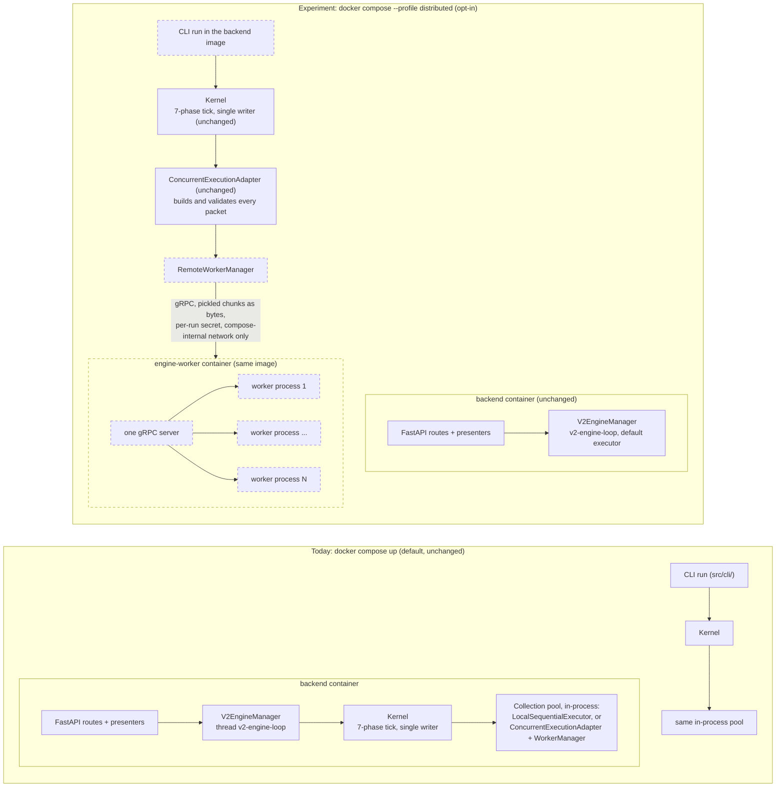
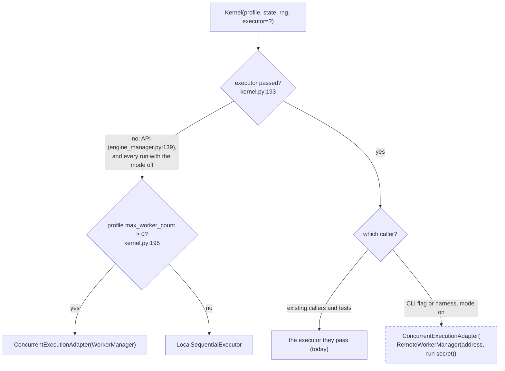
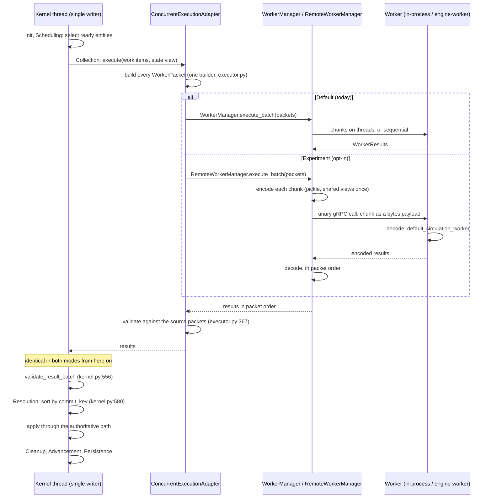
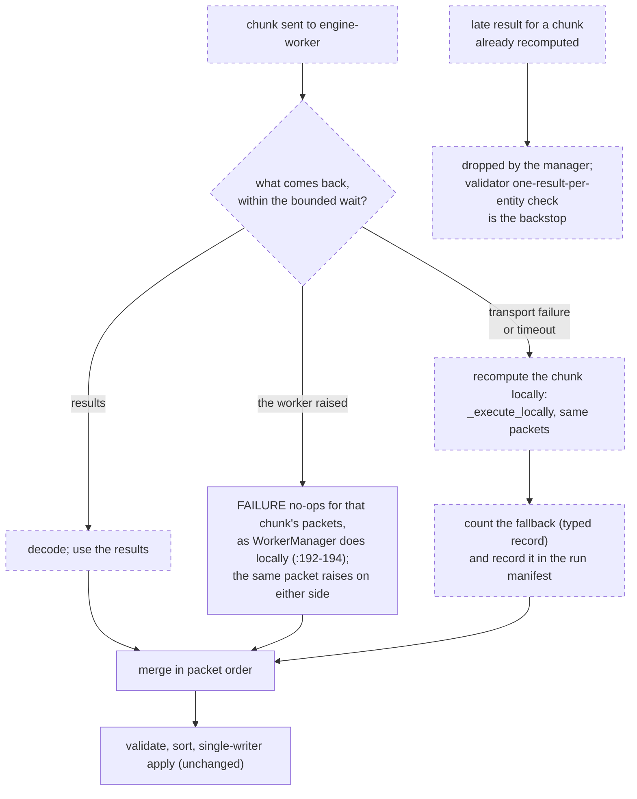

# Distributed-workers experiment mode: design (DRAFT)

**Status: DRAFT, revised after the owner answered §10 (#715 6776551375): local recompute, CLI and harness only, gRPC, pickle with
guards.** For ubuntu's review 2/2, together with the ADR amendment. Design only: no code, tests or runs were written for it, and no
number here is measured. Written by architecture-planner-u24 for `TCK-20261109-DISTRIBUTED-WORKERS-DESIGN`, child 1 of
`TCK-20261109-EPIC-DISTRIBUTED-WORKERS-EXPERIMENT`. Drafted before child 0 (`TCK-20261109-DISTRIBUTED-WORKERS-ADR-AMENDMENT`) lands,
by owner leave (#715 6731956846); it stays inside child 0's five scoped points, and if the ADR narrows them, this doc follows the ADR.
Nothing under the epic is built before the owner has reviewed the whole plan (#715 6731938042). Code facts were read on `main` at
`e755dc3d1`.

**Decisions this doc does not take.** The ADR is lead-planner's. Test-layer and lane placement is testing-planner's (its answer,
2026-11-09, is in §8). Packet-cost measurement is perf-planner's. The engine-side code is rpg-planner's; images and
compose are platform-planner's.

## 1. What the mode is, and what it is not

An **opt-in experiment** that runs the Collection phase's worker packets in a separate container. Nothing else moves: Scheduling,
Resolution, Cleanup, Advancement and Persistence stay in the engine process, and the engine stays the **one writer** that validates,
sorts and applies every result.

It is **not** a speed-up. Collection was 14 to 26 % of a tick in py-spy shares (`docs/performance/tick_cost_growth.md` §2) and
5.2 to 16 % in the benchmark records (`tests/perf/baselines/*.v0001.json`). So the Amdahl ceiling is about 1.05 to 1.35x. Both are
**PROVISIONAL**: one loaded 6-vCPU VM and an uncontrolled runner, neither a quiet-host measurement. The earlier "6 %" lower bound
(`engine_execution_modes_proposal.md` §2) cites a source not found in the repo. Each tick also adds a network round trip and the serialization of large world views. A result slower than sequential is a valid outcome.
It is **not** an API/engine split, an engine replica, a multi-host deploy or a broker change.

### 1a. Today versus the experiment mode, in diagrams

The mode is **one more run mode beside the existing ones, not a replacement**. In the diagrams, dashed boxes are new; everything
drawn solid exists today and does not change. The style follows `docs/architecture/system_overview.md` and
`docs/architecture/kernel_concurrency_design_philosophy.md`.

**Deployment and processes.** With no profile, compose starts exactly today's services. The `distributed` profile adds one
`engine-worker` container that holds N worker processes behind one listener (§7). The run that uses it is a CLI run (§5). The API's
`v2-engine-loop` keeps the default executor, because `engine_manager.py:139` passes none.

**Executor selection.** `kernel.py:193-198` is not edited. The mode enters through the explicit-executor branch that already
exists, and only a CLI or test-harness caller takes it. With the mode off, nothing passes an executor, so selection falls through
to today's two branches.

**One tick, both modes.** Only Collection's transport differs. The packets come from the same builder, and from validation onward
the path is the same code: `ProtocolValidator.validate_result_batch` at `kernel.py:556`, the sort by `ConcurrencyLaw.commit_key`
at `kernel.py:580` (class priority, local priority, entity id), then the single-writer apply in Resolution.

**Slow or dead worker (§6).** Every branch ends in the result the local path would give, so the outcome never depends on worker
speed. A worker exception is handled exactly as locally. A transport failure or timeout recomputes the chunk locally and records
it. A late result is dropped.

## 2. Constraints (from child 0)

1. One writer: workers compute `WorkerResult`s only; `ProtocolValidator.validate_result_batch` checks them against the source
   packets (`kernel.py:556`, and inside the adapter at `executor.py:367`); results are sorted before apply (`worker_contract.md` §3).
2. "One process" is relaxed for the Collection pool only, and only under the opt-in mode.
3. The default is unchanged: `kernel.py:193-198` selection, `LocalSequentialExecutor`, `ConcurrentExecutionAdapter`, `WorkerManager`
   and `docker compose up` with no profile.
4. Determinism: same world and seed give an identical final hash under the current proof scheme (`PROOF_DIGEST_SCHEME`) and `TICK_END` trail to `LocalSequentialExecutor`,
   or the mode is unclaimed (PERF-D2 DET-PORT-1, `docs/engine/deterministic_execution.md`, "Scope of the guarantee"). Outcomes never
   depend on worker speed (`worker_manager.py:192`).
5. An experiment by owner choice (#715 6731714291), standing in for Mode 5's reopen condition.

## 3. The seam: a remote worker manager behind the existing adapter

**Proposal:** add a `RemoteWorkerManager` with the same `execute_batch(packets, worker_fn, force_local, concurrency_limit)` contract
as `WorkerManager` (`worker_manager.py:107`), and hand it to the **existing** `ConcurrentExecutionAdapter(worker_manager=...)`
(`executor.py:213`), passed to `Kernel(executor=...)`.

Why this rather than a new `IWorkExecutor`:
- **Packet building stays in one place.** The adapter builds every `WorkerPacket` (`executor.py` up to `:333`) and
  `test_the_executor_is_the_only_place_that_builds_a_worker_packet` (`tests/unit/kernel/test_executor_context_parity.py:141`)
  holds unchanged. A new executor would be a second packet builder, the drift #837 guards against.
- **Validation stays in one place.** The adapter keeps `_source_packets` and validates results (`executor.py:339,367`).
- **Selection is untouched.** The explicit `executor` branch at `kernel.py:193-194` already exists; nothing in the
  `max_worker_count` branches changes.
- **The worker function is importable by name.** The adapter passes `default_simulation_worker` (`executor.py:341-345`), a
  module-level function, so the worker container calls the same function from the same image.

## 4. Wire format and transport

- **Encode per chunk, not per packet.** The adapter freezes the large world views once per batch and shares them across packets
  (`_batch_views`, `executor.py:221-232`). One `pickle.dumps` per chunk keeps that sharing (pickle's memo writes a shared object
  once); per-packet encoding would copy `all_entities`, `regions`, `spatial_grid` and the tile maps into every packet. The private
  caches (`worker_protocol.py:93-98`) are rebuilt on the worker. Child 2 measures the size either way.
- **Transport: gRPC (owner, #715 6776551375).** One service, point to point: no broker, so `system_overview.md`'s line on
  brokers is unchanged. Two unary RPCs:
  - `Handshake`, once per connection, before any chunk (below);
  - `ExecuteChunk`, one call per chunk. The request and the response each carry the encoded chunk as one opaque `bytes` field,
    plus a chunk id, a wire-schema version, and the **codec name and version**. Protobuf frames the call; it does not type the
    packet.
- **Codec seam (built now).** A small `ChunkCodec` interface (`name`, `version`, `encode(chunk) -> bytes`, `decode(bytes) ->
  chunk`) sits between `RemoteWorkerManager` and the transport. **Pickle is the first codec.** A typed codec (protobuf messages,
  or another canonical encoding) replaces it later without touching the transport, the manager or the `.proto` service.
  - Both sides refuse a codec name or version they don't hold, at handshake, never by guessing.
  - The round-trip and golden tests of §8a run per codec, so a second codec inherits them.
  - Per-call deadlines carry §6's bounded wait. A deadline is liveness only, never outcome.
  - Child 2 still measures the encode size and the round trip, now through gRPC.
- **The dependency.** `grpcio`, plus `protobuf` and `grpcio-tools` if stubs are generated, goes in `pyproject.toml`/`uv.lock` as an
  **optional extra**, for example `distributed`. The default install and the default image don't carry it. That edit goes through
  the leads when child 3 or 4 reaches it, not in this design PR. It moves to core dependencies only at promotion, through the
  leads (§13).
- **Authentication: both ways, with a per-run secret.** Both sides unpickle what they receive, so each side must authenticate the
  other. Client-only auth would let a fake server on the internal network hand the engine a malicious result.
  - The engine generates a random secret per run and passes it to the worker container (env or a compose secret). It never
    appears in the manifest or logs.
  - **Engine to worker:** every call carries the secret in gRPC metadata. The worker rejects a call without it, before decoding.
  - **Worker to engine:** in `Handshake`, the engine sends a nonce, and the worker answers with `HMAC(secret, nonce ‖ image digest
    ‖ content fingerprint)`. That proves the build once per connection.
  - **Every response is authenticated too (ubuntu review 2/2, D1).** gRPC can reconnect transparently, by re-resolving or by
    opening a new subchannel after `UNAVAILABLE`, possibly to a different endpoint. So a one-time handshake does not cover later
    responses. Each `ExecuteChunk` response carries `HMAC(secret, chunk id ‖ codec name and version ‖ SHA-256 of the payload)`. The
    engine verifies it **before decode**, and refuses any response without a valid MAC. A refused response is a transport failure
    (§6: local recompute, counted), and the run's report states it.
  - Accepted risk for the experiment: without TLS, an observer *on the compose-internal network* could read the secret and the
    chunks, and so forge MACs. That network is not published to the host.
  - **Accepted risk: a compromised worker container (D2).** Two-way auth stops an impostor, not a worker container that is itself
    compromised. Such a worker holds the secret and signs valid responses, and the engine unpickles them, so worker RCE becomes
    engine RCE. Accepted for the first build on the internal network. It is closed by promotion gate 3, the typed codec (§13),
    which matters most on the **engine's decode side**.
  - **mTLS is planned**, because the scale case is multi-host. The auth sits behind gRPC channel credentials, so mTLS replaces
    the secret-in-metadata without changing the RPCs. Child 3 may build mTLS first if its security review asks; otherwise it is
    a promotion gate (§13).
- **Trust boundary (owner's guards).** Unpickling network input runs code. The owner's conditions:
  - compose-internal network only;
  - a test that the worker port is never published to the host (child 4, §8a);
  - a security-tagged review of child 3;
  - a typed encoding is mandatory before the mode leaves "experiment".
  This is the **first build of a mode that may become the default at scale** (owner, #715 6776564953). It ships as an opt-in
  profile; promotion is gated (§13).
- **Same build, or refuse.** In the `Handshake` RPC, the worker reports its image digest and a content fingerprint, both bound into
  the HMAC above. The engine refuses a worker whose build differs (a different build is DET-PORT-2, not claimable).

## 5. Selection: how a run opts in

**CLI and test harness only (owner, #715 6776551375).** A run opts in by building the kernel with
`executor=ConcurrentExecutionAdapter(RemoteWorkerManager(address, secret))`; a CLI flag or env var names the worker address.
The API stays out: `V2EngineManager` builds `Kernel(profile=..., state=..., rng=...)` with no executor
(`src/api/engine_manager.py:139`), and that is not changed in the first build. API reach (passing an executor there) is the
expected step at promotion (§13).

## 6. Slow or dead worker rule

**Rule (owner, #715 6776551375: local recompute, recorded):** after a bounded wait per chunk (the gRPC deadline), the engine
computes that chunk **locally**, through the same
`_execute_locally` path (`worker_manager.py:213-224`), from the same packets. The worker function is pure over the packet, so the
results are identical; the fallback is counted and recorded in the run manifest, and a run with any fallback says so in its report.
It **never** answers with a FAILURE no-op: in `WorkerManager` a chunk that raised is answered with FAILURE no-ops (`:192-194`), and
a timeout answered that way would make the outcome depend on speed (constraint 4).

**Exception vs transport failure.** A worker that **raises** reports the exception back, and the engine handles it exactly as
the local path would (FAILURE no-ops, as `WorkerManager` does for a raised chunk): the same packet raises on either side, so the
outcome is the same. Only a **transport** failure or a timeout triggers the local recompute. A late result for a chunk already
recomputed is dropped by the manager; `ProtocolValidator`'s one-result-per-entity check (`src/core/protocol_validator.py:41-50`)
stays the backstop.

The bound is liveness, not outcome, so it may be wall-clock without breaking determinism: whichever side computes the chunk, the
result is the same. The rejected alternative was failing the run on the first timeout.
- **Mapping to gRPC status:** `DEADLINE_EXCEEDED` and `UNAVAILABLE` (and any other transport-level status) mean local recompute. A
  raised worker exception comes back as a normal `ExecuteChunk` response that carries the exception, and is handled as locally. A
  failed handshake refuses the run; it is not a fallback.

Open check (unverified): the rule holds only if `default_simulation_worker` reads nothing outside its packet. The parity test fails
on an undeclared **state** read (`test_executor_context_parity.py:109`), but a read of a process-global singleton (the content
catalog, registries) is not covered; a separate container must load the same content. Child 3 verifies this before it builds the
transport, and the content fingerprint of §4 covers the content side.

## 7. Compose profile

A `distributed` profile adds one service, named `engine-worker` (not to be confused with `ai_worker`, the anomaly consumer at
`compose.yaml:81-89`), from the same backend image, holding N worker processes behind one listener. The engine side runs as a CLI
run in the backend image under the same profile. `docker compose up` without the profile starts exactly today's services.

## 8. Testing strategy (reusing the existing layers)

Placement below is **testing-planner's answer** (2026-11-09, cross-session reply to architecture-planner-u24; advice for the draft,
not an owner approval). Levels are `docs/testing/test_taxonomy.md` §5; markers are `domain("substrate")` with `level("unit")` or
`level("kernel_integration")` (§10).

**Behaviour evidence does not change.** The rpg gate, paired arms and the gate baseline
(`tests/simulation_quality/rpg_gate/baselines/rpg_gate_v1.json`) run on the pinned sequential runner (`tools/rpg_measure`) only.
This is a **guard, not only policy** (testing-planner): the run manifest records the executor mode, and the gate candidate, paired
arms and `rpg_measure` each refuse a non-sequential executor, with a unit test per refusal (child 6). The mode's one claim is
**equivalence**, DET-PORT-1 under PERF-D2 (a backend counts only in a passing parity matrix), proved the way
`tests/integration/kernel/test_executor_equivalence_long.py` proves threads against sequential: the **field-by-field content compare
is the primary check and the canonical hash secondary**, because the digest may omit fields that decisions read
(`TCK-20261103-STATE-DIGEST-MAY-OMIT-FIELDS-THAT-DECISIONS-READ`); zero worker FAILURE no-ops on both arms.

| Child | Level and place | What is new, and why no existing test covers it | Lane |
|---|---|---|---|
| 2 packet cost | none (a measurement) | a size and time record per world; no test layer measures serialization | one-off on the u24 heavy slot, after the owner's review, lead-planner-u24 told first |
| 3 remote manager | unit, `tests/unit/kernel/`: `test_executor_context_parity.py` extended with the remote manager as a third packet consumer | the parity test checks what the packet answers; new is that the answers survive encode and decode | PR, `unit-core-world` |
| 3 | unit: (a) chunk round trip (encode, decode, same results), with a **negative case**: an unknown or missing field, or a version or build mismatch, refuses loudly on decode and never defaults; (b) the dead-worker rule: a timed-out chunk is recomputed locally, identical, never a FAILURE no-op, and the fallback is a **typed counter or record** the test reads (not a log line or reason string); (c) a **late result** arriving after the local recompute is dropped, never applied twice (the regression-prone path) | no test has a network boundary or a timeout; `WorkerManager` has neither | PR, `unit-core-world` |
| 3 | kernel integration, `tests/integration/kernel/`: loopback equivalence (a worker on localhost, no docker) vs `LocalSequentialExecutor` on one world. It **must pass under the medium budget** (60 s alarm, 4 GB) **measured on the slow VM**, with the wall time stated in the PR; if it does not, cut ticks or use a smaller world, **never** mark it `resource_budget_large`. 300 ticks of two arms on `crowded_frontier` is likely already near 60 s, so the tick count is set by that measurement | the long test covers threads only and runs in the slow lane; a PR-time remote arm catches a broken transport early | PR, `integration` |
| 3 | extra_slow: a **sibling file**, remote vs sequential, not a third arm on `test_executor_equivalence_long.py` (its cases sit at the alarm: urban s42 548.7 s locally, frontier s44 alarmed at 601 s). Start with `crowded_frontier` s45 (it carries the known seed cause); more cases only with measured times. **Each new slow-lane test needs testing-planner's sign-off with a measured wall on the slow VM under 540 s**; the slow job is already about 1 h 40 | the same matrix, one more backend: the DET-PORT-1 claim's evidence | `slow-regression.yml` (runs `slow or extra_slow`) |
| 4 compose profile | containerized smoke: the integration case run through the `distributed` profile on one world; `level("kernel_integration")` if it is a pytest | nothing runs compose with an engine worker; `test.yml`'s `docker-build` job builds the image only | a new opt-in workflow or manual dispatch, **platform-planner's call** (not testing's: its globs are `test.yml`, `slow-regression*.yml`, `rpg-gate-report.yml`); kept out of `test.yml` and `slow-regression.yml`; testing-planner reviews its content and placement on request |
| 5 contract docs | none new; existing docs tests (`tests/unit/docs`) keep passing | doc only | PR, `unit-infra` |
| 6 evidence guard | unit: one refusal test each for the gate candidate, paired arms and `rpg_measure`, plus the manifest's executor-mode field | today only policy keeps the mode out of behaviour evidence | PR, the lanes of those tools |

Left out: multi-host networks, tail latency, real container networking beyond one host, and any timing claim.

### 8a. Mapping to the backend testing catalogue (revised 2026-11-09)

The owner shared an external catalogue as reference (58 techniques, 8 categories, P0 to P2; untracked, at
`tmp/backend-systems-review/backend-distributed-systems-testing-strategies.md`). This maps it onto the mode **without adding a test
layer**: every row lands in a §8 layer. Layer and cadence are **testing-planner's answer** (2026-11-09, second reply, after reading
the same catalogue; advice for the draft, not an owner approval). The depth rule (#715 6731764470: fix hard issues only, no effort
beyond the gain) decides the cuts: a technique is kept only if it guards the mode's one claim (equivalence) or its one rule (worker
speed never changes the outcome).

**PR lane, unit** (`tests/unit/kernel/`, `level("unit")`, medium budget):

| Catalogue item (tier) | Already covered by | New for the mode |
|---|---|---|
| Unit, Component (P0) | `tests/unit/kernel/` | `RemoteWorkerManager` through `execute_batch` with a fake transport |
| Contract (P1), Schema compatibility (P1), Golden (P1) | `test_executor_context_parity.py`; `ProtocolValidator` | the packet answers survive encode/decode; the chunk carries a wire-schema version and a build fingerprint, and a mismatch refuses (no cross-version compatibility: a different build is DET-PORT-2, unclaimable); the **wire field list is pinned as a golden** beside the parity test, so a new `WorkerPacket` field fails until the wire carries it |
| Boundary / Negative (P0) | `test_an_undeclared_state_field_read_on_a_packet_fails_instead_of_defaulting` | an unknown or missing field, or a version mismatch, fails loudly on decode, never defaults |
| Property-based (P1) | none (`hypothesis` is a dependency, unused by any test) | an encode/decode round trip over generated packets, **deterministic**: `@settings(derandomize=True, max_examples=<small>, deadline=None)`, no per-run seed |
| Fuzz (P1), bounded | none | mutated or truncated encoded bytes refuse with a typed error: no crash, no hang, no partial packet (with `hypothesis`; no coverage-guided fuzzer). **Meaningful only under a typed encoding** (§10, choice 4): with pickle, mutated bytes cannot be made to refuse safely |
| Idempotency / Dedup (P0*) | `ProtocolValidator._check_one_result_per_entity` raises on a second result for an entity (`src/core/protocol_validator.py:41-50`) | a duplicate result for one chunk id is applied once, and a late result after a local recompute is dropped by the manager before the validator (the validator stays the backstop) |
| Retry / Timeout (P0*) | none (`WorkerManager` has no timeout, `:192`) | the bounded wait and local recompute of §6, tested with a **fake clock, never real sleeps**; the fallback counter is typed. The design has **no retry loop** (a timed-out chunk goes straight to local recompute), so there is no retry limit or backoff to test |
| Ordering / Out-of-order (P1) | the kernel sort before apply (`kernel_concurrency_design_philosophy.md` Part 2) | results arriving out of order merge in packet order, and the world equals the in-order world |
| Poison message (P1) | `WorkerManager` answers a raised chunk with FAILURE no-ops (`:192-194`) | a chunk that raises in the worker takes the declared path of §6 (handled as locally) and does not block the other chunks |
| Backpressure (P1) | `WorkerManager`'s queue-depth fallback (contract §4) | `concurrency_limit` and any in-flight bound are respected, asserted by **counts, not timing** |

**PR lane, kernel integration** (`tests/integration/kernel/`, `level("kernel_integration")`, medium budget measured on the slow VM):

| Catalogue item (tier) | Already covered by | New for the mode |
|---|---|---|
| Differential (P2) | `test_executor_equivalence_long.py` (threads vs sequential) | the loopback test: an in-process fake remote vs `LocalSequentialExecutor`, content compare primary, hash secondary. **Kept despite P2: it is the mode's only claim** |
| Fault injection (P1) + Parameterized (P0) | none | the same loopback test **parameterized over a seeded fault schedule** (drop, delay, duplicate, reorder, worker error); each case gives the sequential world; the seed and schedule are printed in the assert message so a failure reproduces |
| Invariant / Runtime verification (P1) | HardLawMonitor and conservation run in every kernel run | none: kept on in these tests |
| Regression (P0) | every PR lane; gate and paired hashes | none: the default path is unchanged |

**Slow lane** (`slow-regression.yml`, four times a day; the extra_slow sibling file):

| Catalogue item (tier) | Already covered by | New for the mode |
|---|---|---|
| Differential, long horizon (P2) | the long test's cases | remote vs sequential, `crowded_frontier` s45 first, more cases only with measured walls under 540 s and testing-planner's sign-off |
| Soak, Resource exhaustion (P1), cheap form | the large budget (RLIMIT_AS and an alarm) | the same run asserts that open file descriptors and sockets at the end equal the start (the budget does not cap them); no separate soak job |

**Container lane** (platform's opt-in or manual workflow, child 4):

| Catalogue item (tier) | New for the mode |
|---|---|
| E2E, Smoke (P0) | the `distributed`-profile run on one world equals sequential |
| Fault injection, real (P1); Network partition, Failover (P1) | kill the worker container mid-run or block its network: the result equals sequential and the typed fallback counter is above 0. For one stateless worker pool and one writer, partition and failover reduce to this; no chaos programme |
| Schema compatibility, real | a worker on a different image digest is refused |
| Rollback / Deployment (P1) | `docker compose config` without the profile lists exactly today's services |
| AuthN (P0) | a call without the run secret is refused before decode; a worker that fails the handshake HMAC is refused before any result is decoded; a response without a valid per-response MAC is refused before decode, and the chunk is recomputed locally; the worker port is not published to the host (the owner's guard) |

**Existing, nothing new:** SAST and SCA (P0) through `security-scan.yml` (Semgrep, gitleaks); they cover the `grpcio` optional
extra once it is added. Benchmark (P1) is child 2's one-off measurement, not a test.

**Cut as cost over value** (the depth rule):

| Item (tier) | Why |
|---|---|
| Mutation (P2) | testing-planner: not now; a possible later audit of the fallback and dedup paths once built (`tests/mutation`, testing's) |
| Stateful model-based, Randomized (P1) | the sequential executor is the model, and seeds plus the seeded fault schedule are the randomization |
| Load, Stress, Spike, Scalability (P1 / P2) | perf work with no claim to support: PERF-D2 claims equivalence only, and the mode makes no speed claim (§1) |
| Replay / Recovery (P1) | the `TICK_END` trail is compared in the differential cases; checkpoint restore stays a sequential case (conformance X4) |
| Chaos engineering (P2) | rejected by the devops amendment ("No ... chaos tooling"); fault injection covers the mechanism |
| Continuous randomized simulation (P2) | the slow lane's schedule gives the recurrence |
| Exploratory, Acceptance (P1) | the owner's plan review is the acceptance step; not a test layer |

**Not applicable** (the mode has no such part): API functional (no API reach, §5); Database integration, Database migration,
Backup / Restore, Disaster recovery (no database or durable store); Message / Event contract (no broker, a direct call);
Consistency / Convergence, Linearizability (one writer, a barrier per tick, no replicas); Distributed transaction / Saga (no
multi-service transaction); Canary, Shadow / Traffic replay, Synthetic monitoring (no production deployment).

**What our layers cannot cover today** (testing-planner's list; flagged, not solved here):
1. **Wire security** (TLS / auth P0*, DAST P1). Pickled packets over a socket are unsafe deserialization, a remote-code-execution
   surface. There are SAST and SCA but no test layer for a network-exposed service. This is a **design choice, not a test** (§10,
   choice 4), and child 3 gets the security-tagged review (`security-reviewer`) whichever encoding is chosen.
2. **Real-process faults** (kill, partition, latency): no harness; the PR integration job has no docker. The in-process fake covers
   the logic; real faults exist only in the container lane, which child 4 creates.
3. **Coverage-guided fuzzing:** none; bounded `hypothesis` only. Not needed for this claim.
4. **Slow-lane timings:** per-test durations are not recorded in CI (quiet mode; the JUnit artifact returns 403), so "each under
   540 s" cannot be enforced from CI yet. A general gap, sent to lead-planner-u24 by testing-planner.
5. **File-descriptor and socket limits:** the conftest budget does not cap them, so leak checks exist only as in-test assertions.

## 9. Cut lines for children 2 to 5

| # | Child | Owner | Cost (measurement included) | Leaves out |
|---|---|---|---|---|
| 2 | packet-cost measurement | perf-planner | **cheap form:** per-chunk pickled size and encode/decode time on the 3 gate worlds at seed 42, in-process (minutes). It also records Collection's internal split (packet build, encode, compute per chunk, decode, validate), marking any item it cannot measure as unknown (§12). **Full form** only if inconclusive: loopback round trip through one worker container (about an hour) | multi-host; contention; tail latency |
| 3 | `RemoteWorkerManager`, transport, rule of §6, the tests of §8 | rpg-planner | code + unit and integration tests; the extra_slow arm adds about 4 x 2000-tick runs to the slow lane | the container (child 4); API reach (§5) |
| 4 | `engine-worker` entry point and the `distributed` profile | platform-planner | image entry point and profile; one containerized smoke run | k8s/Helm; scaling beyond one host |
| 5 | `worker_contract.md` §5 and `infrastructure_overview.md` (the mode; the `ai_worker` wording at `:159`) | docs/engine owner via lead-planner | doc only | everything else |
| 6 | executor-mode field in the run manifest; refusal of a non-sequential executor in the gate candidate (`tools/test_architecture`), paired arms and `rpg_measure`, with a unit test each | testing-planner scopes it (the gate candidate is its domain); `rpg_measure` and the manifest field with rpg-planner | code + 3 small unit tests, no runs | anything beyond refusing; the mode itself |

Order: 6 first (cheap, and it makes the evidence rule a guard before the mode exists), 2's cheap form, then 3, then 4; 5 any time after
child 0 and ubuntu's docs batch. Every child waits for the owner's review.

## 10. Choices for the owner (answered)

The choices as they were offered, kept for the record. The owner's answers follow them, and they supersede the recommendations
where the two differ.

1. **Dead-worker rule:** local recompute, recorded (recommended), or fail the run on the first timeout.
2. **Selection reach:** CLI and harness only (recommended), or also the API (needs `engine_manager.py:139` to pass an executor).
3. **Transport:** stdlib `multiprocessing.connection` (recommended), unless child 2 shows it is the bottleneck.
4. **Encoding (security):** pickle over `multiprocessing.connection` with HMAC `authkey`, on an unpublished compose-internal network
   (recommended for the experiment: no new code for every packet type, and parity is kept by the one packet builder), **or** a typed,
   validated encoding (no deserialization-to-code surface, and it makes the bounded fuzz of §8a meaningful; cost: a canonical encoder
   and decoder for every packet field type, including `EntityState`, `spatial_grid` and the tile maps, and a new parity surface).
   Either way child 3 gets the security-tagged review. If the mode ever leaves "experiment", the typed encoding becomes required.

**The owner's answers (#715 6776551375, 2026-11-11 on the owner's host; GitHub stamps it 2026-11-10 19:03 UTC):**
1. **Dead worker:** local recompute, counted and recorded (§6). A worker that raises is handled as the local path does.
2. **Selection:** CLI and harness only (§5).
3. **Transport:** gRPC, not the stdlib (§4). The stdlib recommendation above is superseded, and so is its rejection of gRPC.
4. **Encoding:** pickle, with guards (§4, "Trust boundary"). With pickle, the bounded fuzz row of §8a stays deferred until a typed
   encoding exists.

## 11. Risks

- **Slower than sequential**, likely; the experiment reports it rather than hides it.
- **Hidden reads outside the packet** (§6 open check): a singleton the worker container loads differently gives a split. The
  long equivalence test is the backstop; the content fingerprint is the guard.
- **Packet-field drift** across a third consumer: covered by keeping one packet builder (§3) and the parity test.
- **Pickle trust boundary** (§4): unsafe deserialization, a remote-code-execution surface if the channel is reached. Guarded by
  the owner's four conditions, plus two-way authentication with a per-run secret and a MAC on every response. Two accepted
  first-build risks: the plaintext secret on the internal network, and a **compromised worker container**, whose signed results
  the engine still unpickles (worker RCE becomes engine RCE). mTLS and the typed codec (promotion gates 3 and 4, §13) close them;
  the typed codec matters most on the engine's decode side.
- **A new dependency** (`grpcio`): kept as an optional extra, out of the default install and image. SCA (`security-scan.yml`)
  covers it once the leads add it.

## 12. External review response (2026-11-09)

The owner shared an external AI review (untracked, `tmp/distributed_workers_experiment_design_review.md`). It asks for answers, not
a wider scope, and says itself that repository evidence wins. Each answer below is labelled **measured** (PROVISIONAL shares, see §1),
**design** (read in the code) or **unknown**.

**Pattern.** Measured or design, as marked. The design is a bulk-synchronous fork-join, written as coordinator–worker: one barrier
per tick, pure workers and one writer. This is design: `kernel_concurrency_design_philosophy.md` Part 2, and the sort at
`kernel.py:580`. The coordinator's validate and sort are not the bottleneck (measured). "Everything else" outside the strategic
pass, sorting included, is 0.6 to 8 % of `resolution_overhead` (`tick_cost_growth.md`, H5 attribution). Ray, Dask, Spark and
Celery are rejected as references to adopt. Celery is asynchronous, and Ray, Dask and Spark schedule dynamically and add a
runtime. Each would bring a dependency and a scheduler into a per-tick synchronous call whose outcome must not depend on placement.
The actor model does not fit, because workers hold no state between ticks. MapReduce fits only loosely: each worker reads the
whole shared world view, which is the serialization cost §4 addresses.

**Which phases dominate (measured, PROVISIONAL).** The large costs are serial Resolution work, not Collection. In the synthetic
scenarios `combat_engagement` takes 23 to 71 % and `cooperation` up to 59 %. `fused_strategic_pass` takes 92 to 99 % of
`resolution_overhead`, which is 12 to 33 % of the tick. Collection takes 14 to 26 % (`tick_cost_growth.md` §2 and H5). Resolution
is one chained fold over a single `StateUpdate` (`pipeline.py:135-438`), and the single-writer rule keeps it serial. A full per-phase
ms table on a quiet host does not exist. Collection's internal split also does not exist: packet build, encode, transfer, compute,
wait and validate are all **unknown**. That split is child 2's job, and child 2 should record each item the review lists, marking
any it cannot measure as unknown.

**Bottleneck as workers grow.** Prediction: serialization and transfer of the shared world views first, then the coordinator's
serial phases (Amdahl). One measured point supports the direction. A 4-thread pool made Collection 1.6 to 2.1x **slower** than 0
workers, and the GIL-plus-dispatch cause is inferred (`engine_execution_modes_proposal.md` §2). Memory per worker process is
unknown. The engine working set is about 101 to 130 MB (`tick_cost_growth.md` §5), and each worker decodes its own copy of the
chunk's views. Load imbalance between chunks is unknown, and child 2 can record each chunk's compute time. Removing the serial
waste (H1, H2) raises the parallel ceiling more than extra workers would, and that work is already on rpg's queue.

**K containers × N processes.** Not adopted, and recorded as a possible later follow-up only.
- On one host, K containers × N processes are K·N processes on the same cores. They give no capacity that 1 × (K·N) lacks.
- Multi-host is out of scope ("deliberately not distributed", and child 0 keeps that).
- Determinism would hold, because chunk-to-endpoint assignment cannot change the outcome: results are sorted before apply, and §6
  recomputes any lost chunk locally.
- What K adds is routing, a timeout and in-flight bound for each endpoint, a build check for each endpoint, and K-way failure cases
  in the container lane.
- `RemoteWorkerManager` could take a list of addresses later without changing its contract. Static chunking already exists, since
  `worker_manager.py:138` sets `chunk_size = len(packets) // max_workers`. Dynamic balancing has nothing to fix until child 2
  shows imbalance.

The 1 × N experiment already answers the question the mode asks: is a remote Collection equivalent, and what does crossing the
boundary cost? K × N is worth an experiment only if multi-host is ever reopened, by a new ADR.

**Comparative experiment.** Child 2's cheap form plus the existing equivalence tests already cover three rows: sequential, local
concurrent, and 1 × N. A K × N row is cut by the depth rule (#715 6731764470), because its gain over 1 × (K·N) on one host is nil.

**Direction.** Keep the first build bounded, with the current design, and do not defer it. (Superseded in part by the owner's
direction, #715 6776564953: the mode may become the default at scale, so the seams that promotion needs are built now. See §13.)
The review justifies two changes, both made here:
- §1 now labels the 6 to 26 % figures as PROVISIONAL shares;
- child 2 records Collection's internal split, with unknowns marked.

## 13. From first build to a default mode at scale (owner, #715 6776564953)

The owner: "Remember this is not pure experiment but maybe the main mode in the future when the engine scale up". The §10 answers
stand for the first build. This section keeps the design from locking the mode into experiment-only.

**Built now so promotion doesn't need a rewrite:**
- the codec seam (§4), so a typed codec replaces pickle without touching the transport or the manager;
- auth behind gRPC channel credentials (§4), so mTLS replaces the per-run secret without changing the RPCs;
- a list of addresses as a later option for `RemoteWorkerManager` (§12), with no change to its contract.

**What does not scale yet, and stays so in this design:**
- **One engine and one writer.** Every result is validated, sorted and applied by the one kernel.
- **Resolution stays serial.** C-10 (`docs/architecture/performance_optimization_decisions.md`) and the Gate B evaluation
  (PERF-M6-T05) are unchanged.
- **Fan-out is Collection only.** Collection is 14 to 26 % of a tick in py-spy shares (`tick_cost_growth.md` §2) and 5.2 to 16 %
  in the benchmark records (`tests/perf/baselines/*.v0001.json`), both PROVISIONAL (§1). So this mode alone caps near 1.05 to
  1.35x: 1.05 from the 5.2 % record share, 1.35 from the 26 % py-spy share. A default mode at scale needs Resolution's work to fan
  out too, and only after the Gate B evaluation (PERF-M6-T05) and under the next-gen phase contract.

**Where it meets the next-gen engine.** That second step is the accepted next-generation engine ADR
(`docs/architecture/next_generation_engine_adr.md`, #715 6742854335): the kernel/logic phase contract, Level A by default, with
child 2's access audit as its evidence. This doc does not restate it. A future main mode must fit that contract, not fork it:
- remote work units are the contract's declared step units;
- results come back as its typed deltas, merged and committed by the kernel under its commit key;
- the one-writer rule holds.
This mode's transport, codec and dead-worker rule are meant to carry those units unchanged.

**Promotion gates** (all needed; each is evidence, not a promise):
1. A **measured speedup** on the gate worlds, on a quiet host, under `docs/engine/performance_contract.md`.
2. **Zero fallbacks** over a long equivalence run (§8), with content compare primary.
3. A **typed codec** in place, replacing pickle (owner guard, §4), with the bounded fuzz of §8a running. This closes the
   compromised-worker risk (§4, D2), so the engine's decode side comes first.
4. **Multi-host auth:** mTLS (§4).
5. **API reach:** `engine_manager.py:139` passes an executor (§5).
6. **The `grpcio` extra moves to core dependencies,** through the leads.
7. **A new ADR.** Promotion to a default, and any multi-host deploy, reopens `system_overview.md`'s "deliberately not distributed"
   beyond child 0's amendment. That decision is lead-planner's and the owner's, not this design's.
