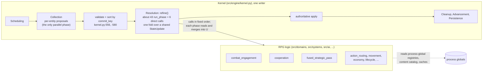
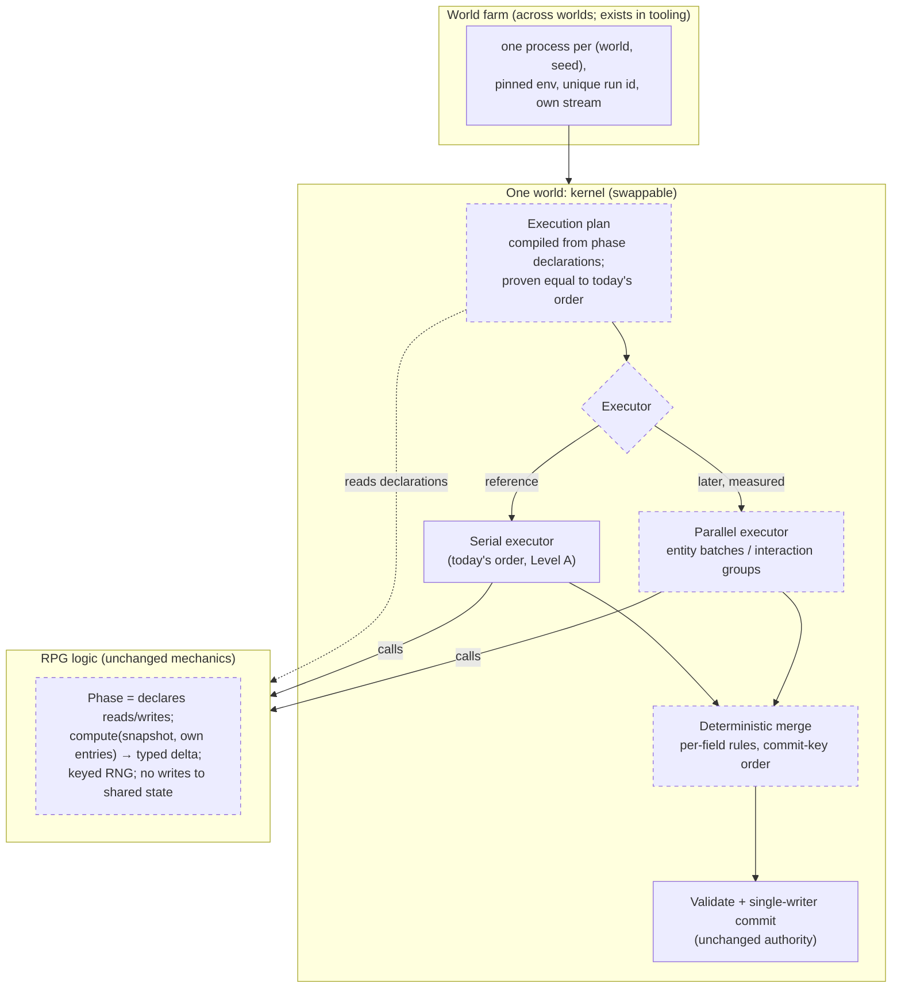

# Next-generation engine: feasibility review (DRAFT)

**Status: DRAFT, for the owner.** This is an investigation only: nothing here was built or run, and no number in it was measured for it.
It answers the owner-shared external review `tmp/distributed_workers_experiment_design_review_2.md` (untracked), plus the owner's own
idea (2026-11-09): split the kernel from the RPG logic so the kernel can be swapped, from today's approach up to fully distributed.
Written by architecture-planner-u24. Code facts were read at `main` `e755dc3d1`.

**This is not an expansion of the distributed-workers experiment.** That epic (`TCK-20261109-EPIC-DISTRIBUTED-WORKERS-EXPERIMENT`) stays
as scoped. This doc is the input to a decision about whether a separate initiative should exist.

**Labels:**
- **[M]** measured: PROVISIONAL unless stated; it cites its source and denominator.
- **[C]** code-derived, cited to file and line.
- **[R]** an external source.
- **[H]** a hypothesis.
- **[U]** unknown.

## 0. Answer in one page

1. **Resolution is serial mostly because of how it is built, not because the simulation needs it.** [C]
   - The three hot steps mostly compute each entity independently inside their own pass, reading tick-start state plus the entity's
     own entry: `combat_engagement`, `cooperation` and `fused_strategic_pass` (§2).
   - "Mostly" is deliberate: cooperation has a cross-entity contention point and an in-place timeline mutation, and combat has an
     order-sensitive witness fold (§2a). **None is claimed parallel-safe yet.**
   - They run serially because every step folds into one shared `StateUpdate`.
   - The true ordering is confined to a few narrow chains: action combat, movement and occupancy, resource contention, the death
     chain, spawn-id allocation, and two order-sensitive merges.
2. **The owner's idea is the right shape, with one condition.** "Swap the kernel" works only if the split happens at the
   kernel/logic **contract**, not just in the folder layout.
   - Each domain phase declares what it reads and writes, computes from a snapshot, and returns a typed delta.
   - The kernel owns ordering, merge and commit.
   - Today's serial kernel becomes the first implementation of that contract, and must stay bit-identical to today (§5).
   - This is also the research consensus: ECS schedulers that run from declared access sets prevent races, but leave determinism to
     a fixed commit order [R, §6].
3. **Within one world, the Python runtime limits how much speed parallelism can buy.** [M]
   - Threads under the GIL made Collection 1.6 to 2.1x **slower**.
   - Processes must pickle world views, and per-task overhead in Ray or Dask is 0.2 to 1 ms [R].
   - Compiling the hot loops, and removing the named waste, comes before parallelising them (Option A, §4).
4. **Across worlds, the concurrency already exists.** [C]
   - The rpg gate, paired runner and capacity runs start one pinned subprocess per world and seed (§7).
   - Recorded architecture already names "scaling per run" as the route.
5. **Direction (the owner's choices, 2026-11-09, §10):**
   - a separate strategic epic now, with an ADR from lead-planner, and no implementation until its gates pass;
   - Level A by default;
   - both scaling dimensions, with the world farm first;
   - E after M1, with stage 1's observe-only audit allowed alongside M1;
   - the depth rule kept, so the order is: re-measure (0), audit (1), contract and ADR (2), serial prototype (3), migrate (4), then a
     measured parallel executor (5).
   
   Option A's perf items come in only on a measured hard issue. Partitioned state (C) and discrete-event or optimistic execution (D)
   are a poor fit for this workload (§4).
6. **Decisions this runs into:** stages 1 to 3 conflict with none. Parallel Resolution needs Gate B and an ADR. Multi-host needs Mode 5
   reopened (§10).

## 1. Current architecture, in one picture

Today the coupling between the kernel and the logic is in the **call contract**. Each phase takes the accumulated update `U` and
returns a bigger `U`, and some phases write caches onto state outside the apply path. The coupling is not in the module layout.

## 2. Dependency analysis of Resolution [C unless marked]

Source: a step-by-step read of `refine` (`src/engine/pipeline.py:136-444`). No existing artifact models reads and writes per step:
- `PhaseDependencyGraph` (`src/engine/phase_graph.py:38`) is a skip table for 31 of 43 phases, with coarse domain tags and no ordering
  edges.
- The Section F per-sub-phase contracts are scoped but were never started.

| Step (pipeline.py) | Reads | Writes | Class |
|---|---|---|---|
| cognition chain: memory, habit, role model, self model (155-193) | tick-start state + own `cognition_bundle_set` | `cognition_bundle_set` (whole-object replace, `updates.py:799`) | **artificial**: chained only by read-then-replace of one object; sub-field deltas would commute |
| information, faction, diplomatic, military (202-292) | tick-start state only | own deltas, merged | **artificial**: they ignore `U` except to merge |
| **cooperation** (218) | tick-start state for every decision (`cooperation/phase.py:67-162`) | own and partner updates, keyed by contract id; additive trust/grudge; an in-place `timeline.append` on state | **artificial** |
| action_routing (298) | state + all of `U`, in ascending id (`actions.py:197-350`) | combat, task, events | **true**: a sliding state where later actors see earlier kills |
| position_swaps, movement_routing (299-300) | occupancy + `U` positions; a live claims map stored on state (`movement.py:188-204`) | positions | **true** (pair matching, claims) |
| **combat_engagement** (321) | tick-start positions; own cognition entry; this tick's fights for the witness tier | own beliefs, properties, cognition | **artificial** in the main loop; **true** read of action_routing in the witness tier |
| interaction, town, world_dynamics, spawns (333-350) | `U` nodes, chests, `entities_add` | inventory, world, spawns | **true**: shared resources; spawn ids from a sequential counter (`generator.py:117`) |
| quest rewards, shop → resource_transactions (358-372) | `U` transfers | inventory | **true**: producer → consumer, reservations in sorted id order (`economy.py:49-57`) |
| evolution, progression (376-382) | `U` XP | attributes | true, entity-local |
| **fused_strategic_pass** (393) | state + only its own `U` entry (`intelligence.py:360-404`) | its own entity's strategic, navigation, identity | true but **entity-local**: no cross-entity read |
| staleness → contradiction (403-404) | state; `U` | leads | true as written (last writer wins); a max-severity merge would remove it |
| near_death, occupancy, lifecycle, death transfers (405-409, 570-578) | `U` hp, positions, alive set | max_hp, rejections, deaths, inheritance | **true**; occupancy is already order-free (lowest id wins, `occupancy.py:105-128`) |
| groups, clans, offers, caps (411-422) | `U`, state | groups, caps | true (contract → group) [H] |
| faction_sentiment (434-438) | every `SocialBondUpdate` this tick | faction values | **true** reduction, and **order-sensitive**: clamped accumulation `max(-1,min(1,prior+delta))` in list order (`apply.py:406-434`) |

**Share of hot cost behind artificial ordering:** **[H, from PROVISIONAL shares]** effectively all of the large measured cost, for
two reasons:
- The three hot steps are entity-independent inside their pass.
- Their cross-step reads are either tick-start state or the entity's own entry.

**Best granularity, per kind of step:**
- **entity** for the cognition, strategic, cooperation and combat_engagement steps;
- **interaction group** (connected components of attacker → target within the radius-10 view, `actions.py:263`) for action combat;
- **tile or region** for movement and occupancy;
- **resource id** for transactions.

Phase granularity is too coarse, and operation granularity adds nothing, because RNG is already keyed (§5).

**The one structural blocker** that chains most of the artificial edges: `cognition_bundle_set` is replaced as a whole object
(`updates.py:799`) instead of merged field by field.

### 2a. The hot steps, by concurrency category (revised after the second review)

"Artificial" in the table above means only that the ordering *between* steps is artificial. It does **not** mean a step is
parallel-safe inside. **No step is claimed parallel-safe** until stage 1's access audit and a Level A proof under a parallel executor
both pass. Declared read/write sets are necessary, but not sufficient.

| Category | combat_engagement | cooperation (re-read 2026-11-09) | fused_strategic_pass |
|---|---|---|---|
| independent per entity | main loop: each actor writes only its own key (`phase.py:294-460`) [C, one read] | the decision for each entity reads tick-start state and the indexes built once per tick (`cooperation/phase.py:67-75`) [C] | each entity reads and writes only its own entry (`intelligence.py:360-404`) [C, spot-checked] |
| independent only because it reads tick-start state | yes, it uses tick-start positions, not movement_routing's (a deliberate one-tick lag in meaning) | yes: `combat_risk` is last tick's value | its neighbour views come from tick-start state |
| cross-entity updates | the witness tier folds several fights into one witness's model, in `entity_updates` insertion order: **order-sensitive** | **JOIN_PARTY writes the offerer's contract promotion into the offerer's update** (`phase.py:175-196`). Two joiners accepting one offer in a tick both promote the same contract; today the loop order over `state.entities` decides. This is a **contention point**, and needs a merge rule (for example, lowest joiner id wins, the rest rejected) | none found |
| order-sensitive merge | witness fold (above) | trust and grudge are float additions across groups (`phase.py:252-265`): **order-sensitive** if a member is in more than one group | none found |
| hidden or shared mutation | none found in the main loop [U for helpers] | **`entity.timeline.append` mutates tick-start state in place** (`phase.py:35-64`, `:116`), and the `len(entity.timeline) < 150` gates read it back within the same pass. Entity-local, but outside the apply path | a cache flag written on state (`:347`) |

**Reading:**
- fused_strategic_pass is the cleanest candidate.
- combat_engagement's main loop is clean, but its witness tier needs a canonical fold order.
- cooperation needs three changes before it is a candidate: a contention rule for contract acceptance, a canonical order for the
  trust and grudge sums, and timeline events moved into the update.

Each of these changes is behaviour-neutral **only if** it reproduces today's order. That is what the Level A proof checks.

## 3. Performance: what is measured, what is not

| Fact | Value | Denominator | Status |
|---|---|---|---|
| Collection | 14 to 26 % | whole tick, py-spy shares, pinned contract | [M] PROVISIONAL, one loaded 6-vCPU VM (`tick_cost_growth.md` §2) |
| Collection | 5.2 to 16 % | whole tick, ms from benchmark records (`tests/perf/baselines/*.v0001.json`) | [M] uncontrolled runner; "do not use for trend claims" |
| 4-thread Collection | 1.6 to 2.1x slower than 0 workers (records: 1.70 to 1.93x) | Collection ms | [M]; cause (GIL + dispatch) inferred |
| combat_engagement | 23 to 71 % | whole tick, synthetic scenarios | [M] pre-H1 |
| H1 hostility cache (#751, merged) | combat_engagement -12 to -15 % at movement_1000; about 1.6 s per tick (about 70 %) remains in `_consider` | phase ms | [M] PROVISIONAL, 2 pairs |
| H2 candidate index (#771, merged) | cooperation 164 → 60 ms on `strategic_100` (-64 %); tick 267 → 164 ms | phase and tick ms | [M] 5 alternating runs, one host |
| fused_strategic_pass | 92 to 99 % of `resolution_overhead`, which is 12 to 33 % of the tick | nested: share of a share | [M] pre-H1/H2; **uncosted** (TCK-20261101-FUSED-STRATEGIC-PASS-RESTRUCTURE open) |
| engine working set | about 101 to 130 MB per world | RSS, collector on | [M] |

**Does not exist** [U]:
- a per-phase ms table on a quiet, controlled host;
- Collection's internal split (child 2 of the experiment records it);
- per-operation call counts and allocations;
- per-chunk load balance;
- memory per worker process;
- several worlds' memory and throughput at once;
- any DET-PORT-1 parity matrix result;
- any profile at 5000 entities;
- an after-H1/H2 re-measure of the whole tick's shares.

`engine_execution_modes_proposal.md` §2 is stale: it still calls H2 unmerged and H1 next.

**Reading:**
- After H1 and H2, the largest named costs are still serial pair work (`_consider`) and the uncosted strategic pass. **[H]** Both are
  CPU-bound Python loops over entities and pairs: the shape where compiling or indexing gains several times, and where GIL threads
  gain nothing.

## 4. Alternatives compared

| Option | What it is | Fit to this engine (evidence) | Cost | Verdict |
|---|---|---|---|---|
| **A** optimise the serial engine | indexes, caches, compiled hot loops (mypyc, Cython or Rust for `_consider` and the strategic pass) | named waste is measured and still large; H2 cut a phase by 64 % behaviour-neutrally [M]; mypyc gives 2 to 4x on typed code [R] | low to medium per hot spot; parity by the existing gate | **not a stage** under the depth rule (owner, Q5): an item enters only when a stage's own measurement shows a hard issue |
| **E** kernel/logic contract (the owner's idea) | phases declare reads and writes, compute from a snapshot plus their own entries, return typed deltas; the kernel owns the plan, merge and commit; executors are swappable | the hot steps already have this shape [C, §2]; the merge rules are the work (§5) | medium to high: every phase signature changes; no mechanics change | **recommended next**, serial executor first |
| **B** parallel compute + central commit | E's contract, run with a parallel executor per entity batch | sound only after E; in CPython, gain depends on free threading or cheap process transfer [R, §6] | the executor itself is small once E exists | **an executor behind E**, measured before it is claimed |
| **C** partitioned state (regions own state) | shards plus halo/ghost exchange plus migration | dense same-tick interactions cross regions (combat rewards, movement, factions, economy pool, spawns; modes proposal 3b blockers); no source claims bit-identity when the partition changes [R] | high, and multi-host is ruled out | **not recommended**; at most region as a *scheduling* key inside E, never as state ownership |
| **D** dependency-driven or discrete-event (PDES, Time Warp) | events run when causally safe, or speculatively with rollback | zero lookahead within a tick (dense pair interactions); Time Warp's checkpoint and rollback cost is large for fine-grained models [R]; same-time-stamp ties need explicit rules anyway | very high | **not recommended** |
| Frameworks (Ray, Dask, Spark, Celery) | a general distributed scheduler | per-task 0.2 to 1 ms and "under about 100 ms tasks you may see no speedup" (Dask) [R]; async models do not fit a per-tick barrier | dependency plus runtime | **reference only** |

A **hybrid** fits: E's contract with **entity** as the default unit, **interaction groups** for action combat, and **region or tile**
as a scheduling key for movement and occupancy. State ownership stays central.

## 5. Determinism and correctness model

**Already guaranteed by architecture** [C]:
- RNG is keyed, not streamed: every draw is seeded from (seed, domain, tick, entity, sub-id) (`src/platform/rng.py:65-105`), and the
  stream calls have no callers. This removes the hardest usual blocker [R: BioDynaMo is only "statistically reproducible" for lack of
  exactly this].
- The commit key is unique (`concurrency_law.py:30-34`), with a duplicate check and a canonical sort.
- An undeclared packet read raises.
- The digest sorts keys and entities.

**Established only by tests:**
- sequential equals 2 threads (four 2000-tick cases);
- arrival-order permutation does not change the result;
- the frozen-view cache is safe (one probe).

The DET-PORT-1 matrix **has never run**. Every harness pins `PYTHONHASHSEED=0`, which can hide residual hash-order effects.

**The contract keeps evolving state visible; it does not force one snapshot.** Many steps read what earlier steps wrote in the same
tick (§2). Forcing every step onto tick-start state would change today's meaning, so the contract has four layers:

| Layer | What it is | Who owns it |
|---|---|---|
| 1. tick-start state | immutable `AuthoritativeState`; nothing writes to it during refine (today's timeline appends and cache flags move out) | kernel |
| 2. a view per step | tick-start state **plus exactly the earlier deltas the step declares** it reads (for example, action_routing declares "all combat deltas so far"; fused_strategic_pass declares "own entity's inventory, strategic and navigation deltas") | kernel builds it from the declaration |
| 3. compute | entity-local or group-local work over the view, returning a typed delta; no writes outside the delta | domain logic |
| 4. merge and commit | per-field merge rules in commit-key order, then the existing validate and single-writer apply | kernel |

A step that needs **sliding** state (action_routing: later actors see earlier kills) declares it, and the kernel runs its units in the
declared order. The contract **exposes** that dependency, and does not hide it. The access audit (stage 1) checks every declaration
against observed reads.

**What a contract kernel must define, so the result does not depend on the schedule:**

| Item | Today | Contract rule |
|---|---|---|
| merge of an entity's update | mixed: add, concatenate, last writer wins (`updates.py:788-803`) | per-field merge rules, declared and tested; whole-object replace of `cognition_bundle_set` split into sub-field deltas |
| cross-entity writes | partner contracts, trust/grudge | keyed by a stable id; commutative (additive) or ordered by commit key |
| reductions | clamped float accumulation in list order (`apply.py:406-434`) | an explicit order (sorted by source id), or integer or fixed-point values |
| id allocation | one sequential counter (`generator.py:117`) | spawn requests sorted, then allocated |
| events | `uuid4` ids (`events.py:56`); ordered `world_events_add` in hashed state | ids derived from (tick, source, seq); events ordered by commit key |
| caches written onto state | `route_plans`, spatial and movement caches via `object.__setattr__` | owned by the kernel or by the phase instance; never on shared state |
| process globals | registries, content catalog, terrain cache, observability config | loaded once per process, checked by a content fingerprint, or owned per world |
| RNG keys | XOR composition; can collide once entity ids pass about 65k; quest keys lack a building id | a hash of the key tuple; fixing this moves pinned hashes, so it is a versioned change |

**Equivalence levels** (the review's A, B, C):
- **Level A (exact legacy equivalence) is achievable for E with a serial executor.**
  - The entity-independent steps produce the same deltas whatever the order.
  - The true chains keep today's order inside the contract.
  - The proof machinery exists: 3 gate worlds hash-equal, `rpg_measure --neutral` IDENTICAL, the `TICK_END` trail, plus the
    content compare, which matters because the digest has known blind spots.
- **Level A also holds for a parallel executor** on the entity-independent steps, if merges are as above.
- **Level B (versioned new semantics) would be needed only to parallelise a true chain.** Examples: simultaneous action combat
  instead of ascending-id sliding state, or a changed reduction. Each is a mechanics change: it goes in
  `intentional_divergences.md`, needs a new determinism tier beside PERF-D2, and needs the owner's approval.
- **Level C is never a correctness claim.**

## 6. Python runtime facts that bound the design [R]

- **Free-threaded CPython:**
  - no longer experimental in 3.14 (PEP 779), with a single-thread cost of about 5 to 10 % (3.13: about 40 %);
  - one C extension without `Py_mod_gil` re-enables the GIL for the whole process.
  - This repo runs 3.13 [M: profiles]. Whether its dependencies declare free-threading support is [U].
- **`InterpreterPoolExecutor` (3.14):**
  - one GIL per interpreter;
  - arguments and results are pickled, and no mutable state is shared.
  - The same transfer cost as processes, without the fork.
- **`multiprocessing.shared_memory`:** shares bytes only. Object graphs still have to be serialised.
- **Compiled code:**
  - mypyc gives about 2 to 4x on typed code;
  - Numba needs nopython code;
  - PyO3 can release the GIL for real parallel Rust.
- **Factorio**, a deterministic simulation that tried threading:
  - a parallel entity update ran slower (cache effects);
  - what paid was parallelising subsystems that are independent by construction and read only the previous tick;
  - a threading determinism bug stayed latent for 7 years.

**Consequence** [H]:
- Inside one world, the order is: make the contract (E), then try a parallel executor. Compiling or indexing a hot loop (A) comes
  in only where a stage measures a hard issue (owner, Q5).
- That executor is likely free-threaded 3.14 threads over entity batches, or a coarse per-tick process batch.
- Whichever it is, it must be measured against the serial kernel, with a speed claim only on measured data.

## 7. Concurrency map: within a world and across worlds

| Level | Today | Opportunity | Gate |
|---|---|---|---|
| within an operation | serial Python loops | compile or index (`_consider`, strategic pass) | only on a measured hard issue (depth rule) |
| between entities in a step | serial loop over entities | **E**, then a parallel executor | E; Gate B for Resolution |
| between steps | a fixed chain | a plan compiled from declarations, proven equal to the handwritten order (brainstorm proposal §3.6) | E |
| between phases or ticks | a barrier per tick, required by determinism | not proposed: action combat and movement read this tick's state | none |
| across processes or containers, one world | Collection only (the experiment) | the experiment measures the cost | the experiment's epic |
| across machines, one world | rejected (Mode 5 dropped) | not proposed | ADR + owner |
| **across worlds** | a subprocess farm already exists in the measurement tooling (`rpg_gate_harness.py:167,293`, `paired.py:103,117`) | a general farm for lab and sweeps | operations only |

**Blockers to the world farm**, cheapest first [C]:
1. one Redis stream per world (`SIM_STREAM_NAME`);
2. unique explicit run ids in the lab (its `rmtree` at `orchestrator.py:171-174`);
3. process-safe run-ledger appends [U];
4. a measured cap of N concurrent worlds per host (replacing the "reaper kills at 3" anecdote);
5. the lab and sweeper starting subprocesses instead of looping in one process;
6. the API: one container per world, or a keyed manager (structural).

Making two worlds share **one** process would also need every process global to become per-world. That is the largest item, and a
farm of one world per process never needs it.

## 8. Recommended architecture

**Separate simulation semantics from the execution topology, at the kernel/logic contract.**

**What stays:**
- the single writer and authoritative apply;
- the mechanics bible;
- keyed RNG;
- the commit key;
- the 7-phase tick;
- the barrier per tick.

**What changes:**
- the phase signature;
- the merge rules;
- where caches live;
- how process globals are loaded.

**What this does not include:** distributed writers, CRDTs, partitioned ownership, PDES, multi-host. All of these remain non-goals
under the recorded decisions (§10).

### 8a. Distributed-ready, not distributed-heavy

E is built with a serial executor and one central commit. Stage 2's ADR must still check that its abstractions would not block a
later parallel or remote executor. This is a compatibility analysis only. It does not cover remote scheduling, multiple writers or
multi-host work.

| Requirement | Where it stands today | What the contract must fix |
|---|---|---|
| stable task identity | entity id plus a commit key (`concurrency_law.py:30-34`) | a task id = (tick, step, unit), where the unit is an entity, an interaction group or a tile |
| explicit dependencies and scheduling boundaries | an implicit chain in `refine` | step declarations (layer 2, §5); a plan compiled from them and proven equal to today's order |
| deterministic merge and conflict semantics | mixed merges; the cooperation contention point (§2a) | per-field merge rules; a contention rule for each contended key |
| RNG independent of the worker | keyed already (`src/platform/rng.py:65-105`) | a hash of the key tuple instead of XOR (a versioned change) |
| data locality and transfer | Collection shares frozen views per batch; the experiment measures pickle cost | each step declares its view, so a remote executor knows what to send; views stay read-only |
| bounded concurrency, resource governance | `WorkerManager` bounds, the governor, budgets | the executor takes a bound; outcomes never depend on it (constraint of PERF-D1 A2) |
| replay and failure recovery | checkpoints, `TICK_END` trail; failure = FAILURE no-op per entity | the same failure semantics per unit; a lost unit is recomputed, never dropped (the experiment's §6 rule) |
| versioned execution contracts | PERF-D2 tiers; the current proof scheme (`PROOF_DIGEST_SCHEME`) | the contract version is recorded in the run manifest; a contract change is a versioned decision |

## 9. Smallest prototype, and a staged roadmap

**Prototype (stage 3), one vertical slice: `fused_strategic_pass`.** Why this step:
- it is the largest uncosted serial cost;
- it is strictly entity-local [C];
- its restructure is already an open ticket.

The slice:
1. Express it under the new contract: declared reads and writes, `compute(snapshot, own entry) → delta`.
2. Run it under the **serial** executor of a contract kernel that wraps the rest of `refine` unchanged.
3. Success criteria:
   - bit-identical final hash under the current proof scheme (`PROOF_DIGEST_SCHEME`) and `TICK_END` trail on the 3 gate worlds at seed 42 for 300 ticks;
   - the long equivalence cases unchanged;
   - `rpg_measure --neutral` IDENTICAL x3;
   - a runtime **access audit** (shadow mode) showing the step's real reads and writes equal its declaration across those runs;
   - the step's per-tick cost recorded, with no speed claim.
4. Second slice, only if the first passes: a parallel executor for that one step. Success means a hash equal to serial at workers 1,
   2 and 4 (a DET-PORT-1 row) and a measured wall time. A speed-up is reported, not required.

**Stages**, each with its own acceptance criteria; the existing engine stays the reference throughout:

| Stage | Content | Owner (by routing) | Exit |
|---|---|---|---|
| 0 | re-measure after H1/H2 on a quiet host; profile actual Resolution costs, including `fused_strategic_pass` (measurement only, no optimisation) | perf-planner | per-phase ms table with denominators |
| 1 | the read/write declaration audit (Section F, revived) plus the shadow access audit, including hidden mutations of state and process globals; **observes only, so it may run alongside M1** | architecture design, rpg implementation | declarations equal observed access on the gate worlds; the §2a hidden mutations listed |
| 2 | contract and merge-rule spec: the four layers of §5, sub-field cognition deltas, reductions, id allocation, event ids, caches off state, the §8a readiness items | architecture → ADR by lead-planner | ADR accepted |
| 3 | prototype slice under the serial executor (**after M1**, owner Q4) | rpg-planner | Level A proof above |
| 4 | migrate the remaining eligible steps; true chains wrapped in order | rpg-planner | Level A on every lane |
| 5 | parallel executor, measured; free-threaded 3.14 evaluated | perf-planner | DET-PORT-1 rows pass; measured gain or a recorded "no gain" |
| — | world farm for the lab and sweeps (independent of 1 to 5, first in priority, owner Q3) | platform / perf | N worlds per host measured |

Perf items (Option A) are not a stage. They enter only when a stage's measurement shows a hard issue (owner, Q5).

**Level A evidence for every migrated step or new executor** (from the second review):
- a field-by-field state compare, which is primary, because the digest has gaps;
- the canonical hash;
- the `TICK_END` trail;
- the existing behaviour evidence (gate, paired arms);
- for an executor, schedule and worker-count independence (worker counts 1, 2 and 4, and permuted arrival);
- exception and failure semantics equal to today's (FAILURE no-op per entity).

A matching hash alone is never enough.

## 10. Risks and unresolved decisions

**Decisions this runs into** (none is changed by this doc):

| Decision | Where | Affected stage | Owner |
|---|---|---|---|
| one process, one writer, single replica | `system_overview.md` "deliberately not distributed"; devops ADR and amendment | none (the writer stays single); multi-host only | lead-planner (ADR) |
| Mode 5 dropped; target scale offline research on one machine | #715 6408481790, 6409936521 | multi-host only | the owner on #715 |
| Resolution stays serial (C-10); concurrent Resolution is Gate B (PERF-M6-T05) | `performance_optimization_decisions.md` | stage 5 (and stage 4 if it changes ordering) | perf-planner proposal, then lead-planner ADR |
| DET-PORT tiers | PERF-D2 | stage 5 claims; any Level B change needs a new tier | perf-planner drafts, owner approves |
| sub-phase declarations "not a presumed step toward concurrency" (C-14) | design_enhancement_roadmap Section F | stage 1 is fine as declarations; using them for concurrency is the Gate B question | perf-planner |

**Two conflicts in the recommended order itself** (raised by lead-planner-u24, 2026-11-09):
- **Option A against the depth rule.** The owner's standing rule (#715 6731764470) is foundation first: fix hard issues only, with
  no effort beyond the gain. Compiling hot loops, and further perf work beyond the already-merged H1 and H2, conflicts with that rule
  unless the owner sets it aside. Without A, the order is E (the contract, serial executor) first, and A's items go only where a
  stage's own measurement makes them a hard issue.
- **E against current src/engine work.** The kernel/logic split touches src/engine across the board: the `StateUpdate` fold, every
  domain phase's signature, and the executor seam the distributed-workers epic uses. That overlaps rpg-planner's M1 work and ubuntu's
  `docs/engine` contracts batch. Where E sequences relative to M1 is the owner's call (question 4 below).

**The review says the owner's objective has changed** toward a distributed engine. No ruling on #715 records that, and the last one
(6408481790) set one machine. If the owner wants that direction, the first step is a ruling on #715. Stages 0 to 4 do not need it.

**Risks:**
- **E is a large refactor of every phase signature.** It changes no mechanics, but it touches every domain. Mitigations: slice by slice,
  the serial executor as reference, and the access audit.
- **The digest has blind spots** (`TCK-20261103-STATE-DIGEST-MAY-OMIT-FIELDS-THAT-DECISIONS-READ`; caches outside the digest), so a
  split can hide. The content compare is primary for every proof.
- **Within-world speed may not come** in CPython even after E. That is acceptable: E's own value is the swappable contract and
  testable phases. Stage 5 reports "no gain" if so.
- **Free-threading dependency support is unknown** [U].
- **RNG key hygiene and event ids** are cheap to fix, but they move pinned hashes, so they are scheduled as versioned changes.
- **Stale docs:** modes proposal §2/§3/§6/§8 Q3 on H1/H2. Routed as a finding, not fixed here.

**Owner's answers (2026-11-09).** The owner agreed with the choices in the second external review
(`tmp/next_generation_engine_feasibility_review_review.md`). They are confirmed on #715 (6735575831, "Confirm all five (Recommended)"): Q1 (a), Q2 (a),
Q3 (c), Q4 (a), Q5 (a). Q1 differs from this doc's recommendation, (b) then (a). Creating the epic now authorises **no
implementation**. Its children stay behind the ADR, stage 0's numbers and M1's completion.

**Delivery model.** The owner also set it on #715 (6735575831, "Trunk, additive stages (Recommended)"):
- no long-lived integration branch;
- small additive PRs on `main`, behind the existing selection, with the current engine path untouched and selected as today until
  equivalence is proven;
- an equivalence test in every stage PR;
- the `src/engine` stages sequenced by rpg-planner around M1;
- spike branches thrown away, never merged.

The details are in §12.

**Multi-host.** It is outside every stage here, and is not rejected for good. Mode 5's reopen path is recorded: an ADR amendment by
lead-planner, on the owner's decision.

**The questions as asked** (kept for the record):

1. **A separate initiative, or the existing queues?**
   - *Context:* stages 1 to 5 (declarations, contract spec, prototype, migration, parallel executor) are months of cross-owner work,
     with their own ADR. Stage 0 (re-measure, cost the strategic pass) and the world farm are small, and fit today's perf and
     platform queues without a new initiative.
   - *Options:*
     - (a) a separate epic, with lead-planner writing its ADR;
     - (b) only stage 0 and the world farm, on the existing queues, and decide on E after stage 0's numbers;
     - (c) nothing now.
   - *Recommended:* (b) first, then (a) once stage 0 shows where the time goes after H1 and H2. Today's shares predate both fixes.
2. **Which equivalence target?**
   - *Context:* the levels are defined in §5.
     - Level A means results identical to today's engine: same hash, same `TICK_END` trail, same content. All existing evidence (gate
       baselines, paired arms) stays valid, and every step is provable against today's engine.
     - Level B allows reviewed, versioned changes of meaning, for example resolving action combat simultaneously instead of in
       ascending id order. That frees the true chains for parallelism, but it changes gameplay outcomes, needs an
       `intentional_divergences.md` entry and a new determinism tier, and resets the behaviour baselines.
   - *Options:*
     - (a) Level A throughout, with each Level B change as its own owner decision;
     - (b) allow Level B from the start.
   - *Recommended:* (a). §2 shows that the hot cost sits in steps that are parallelisable at Level A.
3. **What is the long-term aim?**
   - *Context:* the two aims are different problems (§7).
     - Many worlds at once (seeds, sweeps, experiments) is close to ready: the tooling already runs one process per world. It needs
       a stream name per world, unique lab run ids and a measured cap per host. It changes no engine code.
     - Speed inside one world (bigger or faster single worlds) needs E and then a parallel executor. In CPython the gain is
       uncertain: threads were measured slower, and processes pay transfer costs.
   - *Options:*
     - (a) many worlds;
     - (b) within one world;
     - (c) both, with many worlds first because it is cheap.
   - *Recommended:* (c). If the real goal is more experiments per day, (a) alone may be enough.
4. **Where does E sit relative to rpg-planner's M1 work?**
   - *Context:* E changes the signature of every Resolution phase and the `StateUpdate` merge, and these are the same files M1
     changes. Running both at once would make every PR conflict and blur which change moved a hash. The distributed-workers epic's
     executor seam and ubuntu's `docs/engine` contracts batch are in the same area.
   - *Options:*
     - (a) after M1 lands;
     - (b) before M1, pausing it;
     - (c) slice by slice, with each E slice taking one phase that M1 is not touching, coordinated by rpg-planner.
   - *Recommended:* (a). Stage 1 (declarations and the shadow access audit, which add no signature changes) can run alongside M1,
     because it only observes.
5. **Is Option A exempt from the depth rule?**
   - *Context:* the depth rule (#715 6731764470) puts the foundation first, fixes hard issues only, and spends no effort beyond the
     gain. Option A is perf work: compiling `_consider` and the strategic pass, and further indexing. It is the cheapest likely speed
     gain, but it is speed work on mechanics that may still change. Without A the order starts at E, and a perf item comes in only
     when a stage's own measurement shows a hard issue (for example, the strategic pass dominating after H1 and H2).
   - *Options:*
     - (a) keep the rule, so the order starts at E;
     - (b) set it aside for named hot spots only, each sized to its measured gain;
     - (c) set it aside for this initiative.
   - *Recommended:* (a). The rule matches where the project is, and E keeps value without A: testable phases and a swappable kernel.

## 11. Response to the second external review (2026-11-09)

Source: `tmp/next_generation_engine_feasibility_review_review.md` (untracked). Verdict: it approves the direction and asks for targeted
revisions. Each point below is checked against the repository.

| Point | Response | Justification |
|---|---|---|
| Q1 to Q5 choices | **Accepted** by the owner (§10) | Q1 (a) differs from this doc's (b)→(a). The epic is created as scoping only, so the difference is in timing, not in what may start |
| Q1: the initiative does not authorise implementation | **Accepted** | matches the gates in §12 |
| measurements set priority, not architectural value | **Accepted** | E's value (testable phases, a swappable kernel) does not depend on a speed-up (§10 risks) |
| 3.1: separate the concurrency categories; verify cooperation | **Accepted, and it corrected this doc** | cooperation re-read: a contract-acceptance contention point, an in-place timeline mutation, and trust/grudge float sums (§2a). §0 item 1 is softened. No step is claimed parallel-safe |
| 3.1: declared sets are not sufficient | **Accepted** | stage 1's shadow access audit plus a Level A proof under a parallel executor are both required |
| 3.2: the contract preserves evolving state | **Accepted** | the four layers of §5; declared earlier deltas, and sliding state declared rather than hidden |
| 3.3: distributed-ready, not distributed-heavy | **Accepted** | §8a, a compatibility checklist for stage 2's ADR |
| §4: multi-host is not permanently rejected | **Modified** | true, but it stays outside this epic; reopening is the recorded Mode 5 path (an ADR amendment by lead-planner, on the owner's decision). It is not an objective of this epic |
| §4: both dimensions evolve independently | **Accepted** | the world farm has its own child and no dependency on E |
| §5: Level A evidence list; a hash alone is insufficient | **Accepted** | §9 evidence list; the content compare is primary because of the digest gaps |
| §6: an internally consistent order under the depth rule | **Accepted, and it corrected this doc** | §0, §4 (A), §6, §7 and §9 were aligned; perf items enter only on a measured hard issue |
| §7: the scope boundaries | **Accepted** | the distributed-workers epic is unchanged; E does not mix with M1 (stage 3 after M1); stage 1 observes alongside M1; no framework, distributed writers, partitioning or rollback without a separate justification |
| §8 item 2: conflicts with ADRs, decisions and schedules | **Accepted** | §10 table; plus the M1 overlap, and the executor seam shared with the distributed-workers epic (child 3) |
| the suggested stage order | **Accepted** | identical to §9 |

**Conflicts that remain, and need decisions later:**
- Parallel Resolution (stage 5) still needs Gate B (C-10, PERF-M6-T05) and an ADR. Stage 2's ADR is the natural place to file it.
- Stage 1 adds runtime instrumentation in `src/engine` (rpg's code), alongside M1. It must stay observe-only, with no hash change,
  proven by the gate.

## 12. Strategic epic and ADR scope

Only what is needed to carry the decision. There is no implementation backlog: stages 3 to 5 are listed in the epic but **not cut**
until their gates pass.

**Delivery model** (owner, #715 6735575831: "Trunk, additive stages (Recommended)"):
- **No long-lived integration branch.**
- **Each stage lands on `main` as small additive PRs, behind the existing selection.** The current engine path is untouched and
  selected exactly as today. Nothing switches to the new path until equivalence is proven.
- **Every stage PR carries an equivalence test** against the current path (the Level A evidence of §9).
- **Stages that touch `src/engine` are sequenced by rpg-planner around M1.**
- **Throwaway spike branches are allowed, and never merged.**

Filed with the epic (`TCK-20261109-EPIC-NEXT-GENERATION-ENGINE`):
- child 0, the ADR;
- child 2, the stage 1 access audit;
- child 4, architecture's contract spec.

The other children are cut by their owning planners, as with the distributed-workers epic.

| # | Child | Owner (by routing) | Filed by | Gate before it starts |
|---|---|---|---|---|
| 0 | ADR: the kernel/logic contract as the engine's direction. Single writer kept; Level A default; the delivery model above; the four layers of §5; the §8a readiness checks; **the Gate B question for stage 5** (C-10, PERF-M6-T05) | lead-planner (ubuntu); it touches the same "one process" decision (`system_overview.md`) as the distributed-workers ADR, so lead-planner may combine the two | architecture-planner-u24 (`TCK-20261109-NEXT-GENERATION-ENGINE-ADR`) | the ubuntu lead reachable; ubuntu's `lead-docs-review-source` batch landed |
| 1 | stage 0: re-measure after H1/H2 on a quiet host, per-phase ms with denominators, Resolution profile | perf-planner | perf-planner | none; measurement only |
| 2 | stage 1: declaration audit plus shadow access audit; observe-only, off by default, hash-neutral (rpg-planner's conditions, 2026-11-09) | architecture's implementer, reviewed by rpg-planner | architecture-planner-u24 (`TCK-20261109-NEXT-GENERATION-ENGINE-ACCESS-AUDIT`) | design now; code after child 0, after the three RPG heads are pushed, in a gap rpg-planner names |
| 3 | world farm: a stream per world, unique lab ids, measured worlds per host | platform-planner; perf-planner for the measurement | platform-planner | none (independent; first in priority) |
| 4 | contract and merge-rule spec (the ADR's detail) | architecture | architecture-planner-u24 (`TCK-20261109-NEXT-GENERATION-ENGINE-CONTRACT-SPEC`) | ADR accepted; child 1 and child 2 results |
| 5 | stages 3 to 5 (prototype, migration, parallel executor) | rpg-planner; perf-planner for 5 | **not cut**: listed only | M1 complete; child 4 accepted; for 5, Gate B |

The epic also records:
- the binding decisions of §10;
- the boundaries of §11;
- that the distributed-workers experiment stays as scoped. Its executor seam is the one point of contact, and child 4 states how it
  fits.
